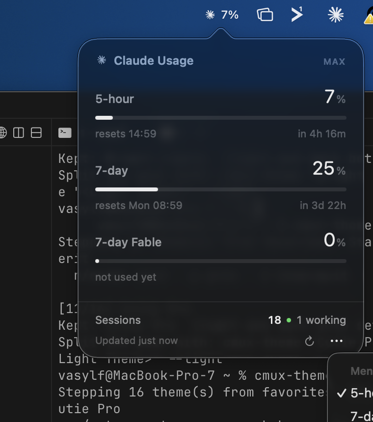

# Claude Usage

A macOS menu bar app for your Claude usage limits: how much of the 5-hour and 7-day windows
you have spent, when they reset, and how many Claude Code sessions are burning them.



No terminal has to be open, and it does not touch your Claude Code status line.

## The one design rule

**Grey means fine.** The bars and the numbers stay monochrome below 60%, then yellow,
orange, red. While calm the menu bar icon is a *template image*, so macOS tints it with the
menu bar's own appearance and it disappears into the system items — which is the point.
Colour is an interruption, and it is spent only on a warning.

The pace forecast obeys the same rule: it does not appear unless your current burn rate
would exhaust a window *before* that window resets. Its absence is the good news.

Some plans carry a weekly limit for one model on top of the shared one — today that is
Fable. Those rows are labelled with the name the server gives them, so a new model needs no
code change, and **Show per-model limits** in the `⋯` menu turns them off for anyone who
does not use them.

The menu bar item is the Claude mark plus the percentage — the mark says whose usage this
is, the number says how much. A progress ring beside the number would say the same thing
twice, so the ring appears only when **Show percentage** is off.

**The number is the 5-hour window**, always, so a glance means the same thing every day. It
can be switched to the 7-day window, or to whichever window is fullest, under **Menu bar
shows** in the `⋯` menu — but "whichever is fullest" is not the default on purpose: a
number that silently changes which thing it measures is a number you have to double-check.

## Install

Requires macOS 14+ and Swift 6 (Xcode 16+). No dependencies.

```sh
git clone https://github.com/vasfal/claude-usage
cd claude-usage
Scripts/build-app.sh                          # builds, signs, installs to ~/Applications
open "$HOME/Applications/Claude Usage.app"
```

On first launch macOS asks whether the app may read the `Claude Code-credentials` item in
your keychain — that is the OAuth token it uses to call the usage endpoint. Choose **Always
Allow**. It asks again after a rebuild, because the ad-hoc code signature changes with the
binary.

Turn on **Open at login** from the `⋯` menu in the panel.

## Where the numbers come from

`GET https://api.anthropic.com/api/oauth/usage` — the same endpoint `/usage` uses inside
Claude Code — authorised with the token already in your keychain. Nothing is sent anywhere
else, and the token is never written to disk or logged.

The endpoint is undocumented. Its shape, captured live:

```json
{ "five_hour": { "utilization": 7.0,  "resets_at": "2026-08-06T12:00:00.198123+00:00" },
  "seven_day": { "utilization": 25.0, "resets_at": "2026-08-10T06:00:00.198149+00:00" },
  "limits": [
    { "kind": "session",       "percent": 7,  "resets_at": "…", "scope": null },
    { "kind": "weekly_all",    "percent": 25, "resets_at": "…", "scope": null },
    { "kind": "weekly_scoped", "percent": 0,  "resets_at": null,
      "scope": { "model": { "display_name": "Fable" } } } ] }
```

`Tests/` pins that shape, so if Anthropic changes it the tests fail rather than the app
silently showing nothing. The last raw exchange is always written to
`~/Library/Application Support/Claude Usage/last-response.json`.

Only Claude.ai Pro and Max accounts get these windows. On other plans the endpoint returns
no limits and the app says so.

Sessions come from `~/.claude/sessions/*.json`, one file per session, named by pid. Those
files outlive their processes, so each pid is checked with `proc_pidpath`. Note that
`proc_name` is useless here: Claude Code's executable is named after its version
(`~/.local/share/claude/versions/2.1.222`), so the process is called "2.1.222" and never
"claude".

## Behaviour worth knowing

- **Polling** is every 120 seconds. On HTTP 429 it backs off, doubling to a 15-minute
  ceiling and honouring `Retry-After`. Launching the app and opening the panel both respect
  that queue; only the ⟳ button forces a request.
- **A failed request never blanks the reading.** The last good value is cached to disk, so
  a relaunch shows a number immediately, and the footer says how old it is and that it is
  retrying. The windows only move while Claude is being used, so a slightly stale number is
  still broadly true — an empty one never is.
- **The forecast** needs three samples spanning four minutes and a window already past 12%.
  Early in a window it is simply absent.
- **The icon appears on the menu bar of whichever display is active.** If that menu bar is
  full, macOS silently drops the newest item; ⌘-drag the items to reorder, or turn off
  **Show percentage** to make this one narrower.

## Layout

```
Sources/ClaudeUsage/
  Main.swift          AppKit entry point — see the comment there for why not SwiftUI's App
  AppDelegate.swift   the status item and the popover
  MenuBarIcon.swift   the mark, number and ring, drawn with Core Graphics for exact pixels
  PanelView.swift     the dropdown, SwiftUI hosted in an NSPopover
  UsageStore.swift    polling, backoff, the on-disk cache of the last good reading
  UsageAPI.swift      the request
  Usage.swift         the response, and the reader that the tests pin
  Keychain.swift      reading Claude Code's OAuth token
  Sessions.swift      live session discovery
  Forecast.swift      rolling history and the pace projection
  Palette.swift       the grey-until-it-matters level scale
Scripts/build-app.sh  assembles, signs and installs the bundle
```

## Development

`swift test` covers the response reader, the level scale and the keychain shape.

The bundle is assembled in a scratch directory rather than in the checkout, because
codesign refuses to sign anything carrying the `com.apple.FinderInfo` and fileprovider
xattrs that iCloud Desktop syncing attaches — a trap if you keep code under a synced
Desktop.

To screenshot the panel without a human clicking it:

```sh
defaults write com.vasfal.claude-usage autoShowPanel -bool true
open "$HOME/Applications/Claude Usage.app"    # the panel opens after five seconds
defaults delete com.vasfal.claude-usage autoShowPanel
```

## Trademark

Claude and the Claude mark are trademarks of Anthropic. This project is not affiliated with
or endorsed by Anthropic, and it ships none of their artwork: the menu bar glyph is loaded
at runtime from the copy of Claude.app already installed on the machine, and a plain
asterisk is drawn when there is none.

## Licence

MIT — see [LICENSE](LICENSE).
